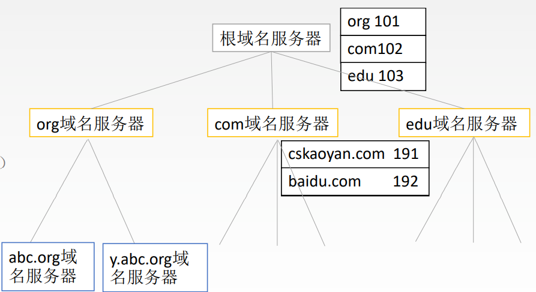
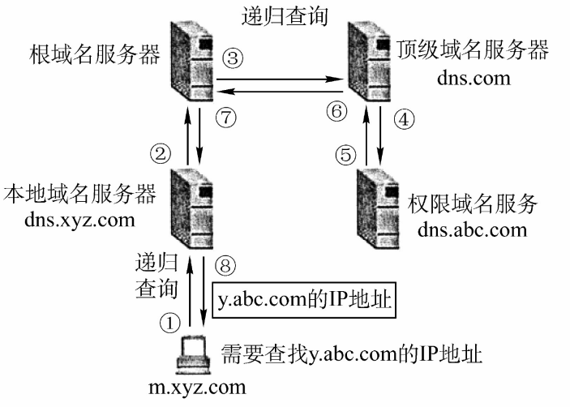
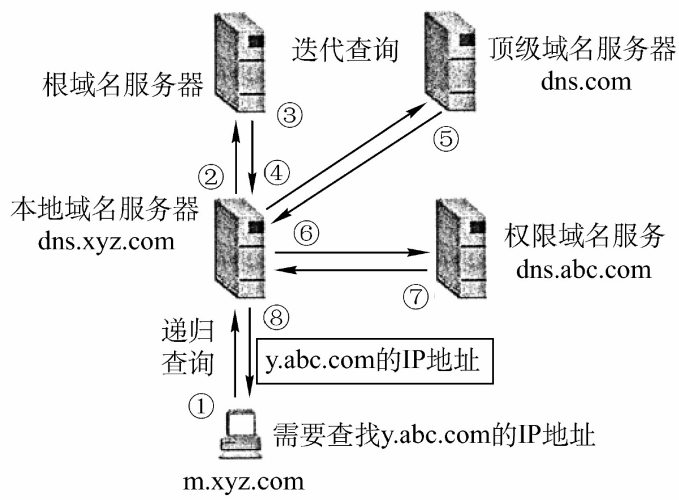

# 6.2 域名系统（DNS）

## 6.2.1 域名

<mark style="color:blue;">**www**</mark>.<mark style="color:green;">**cskaoyan**</mark>.<mark style="color:red;">**com**</mark>

- <mark style="color:red;">**顶级域名**</mark>
  - **国家顶级域名**：cn，us，uk
  - **通用顶级域名**：com，net，org，gov，int，aero，museum，travel
  - **基础结构域名/反向域名**：arpa
- <mark style="color:green;">**二级域名**</mark>
  - **类别域名**：ac，com，edu，gov，mil，net，org
  - **行政区域名**：bj，js
  - **自己注册的**：必须要全球唯一
- <mark style="color:blue;">**三级域名**</mark>
- 四级域名
- ……

### 域名的特征

- 域名不区分大小写
- 常见主机名的标号使用字母、数字和连字符 `-`；DNS 中的其他名称可采用不同规则
- 域名中的每一段称为一个<mark style="color:purple;">**标号**</mark>
  - 单个标号不超过 63 字节
  - 完整域名的 DNS 线格式不超过 255 字节，包含长度字段和根标号

## 6.2.2 域名服务器

- **根域名服务器**：存储各个顶级域名对应的顶级域名服务器地址
- **顶级域名服务器**：管理该顶级域名注册的所有二级域名
- **权威域名服务器**：负责一个区的域名服务器，保存所管理区域的资源记录，回答相关查询
- 本地域名服务器：当一个主机发出 DNS 查询请求时，这个查询请求报文就发给本地域名服务器，本地域名服务器先查缓存；未命中时通常从根服务器开始逐级查询

## 6.2.3 域名解析过程

- 常规 DNS 查询通常使用 UDP，也可使用 TCP；例如 UDP 响应被截断时可改用 TCP。区域传送通常使用 TCP。
- DNS 还可通过加密传输方式提供服务。

### 1、递归查询

被查询的服务器代替请求方继续查询，最终返回结果。主机向本地域名服务器通常发起递归查询。

### 2、迭代查询

本地域名服务器通常依次向根、顶级域和权威域名服务器查询；前面的服务器返回下一级服务器的线索，最后取得记录并缓存。
