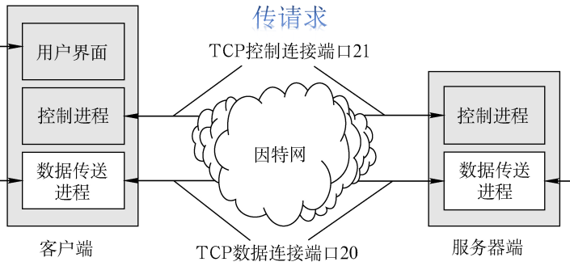

# 6.3 文件传输（FTP）

**文件传送协议 FTP（File Transfer Protocol）**：提供不同种类主机系统（硬、软件体系等都可以不同）之间的文件传输能力。

- FTP 是基于<mark style="color:purple;">**C/S**</mark>的协议
- FTP 使用<mark style="color:purple;">**TCP**</mark>实现可靠传输
- 用户通过一个客户机程序连接至在远程计算机上运行的服务器程序
- **FTP 服务器**：依照 FTP 协议提供服务，进行文件传送的计算机
- **FTP 客户端**：连接 FTP 服务器，遵循 FTP 协议与服务器传送文件的电脑

## 6.3.1 FTP 工作原理

**登录**：用户通过用户名密码的方式登录到服务器，也可以通过匿名登陆访问公开共享的文件。

### 1、FTP 的服务器进程（典型实现）

#### （1）主进程

- 只有一个
- 一直打开，准备响应新的请求

#### （2）从属进程

- 多个
- 需要时打开，负责处理一个客户端的会话
- 会话结束后关闭

### 2、工作步骤

1. 打开控制端口（21），使得客户进程能够连接
2. 等待客户进程发送请求
3. 启动从属进程处理客户端会话
4. 主进程继续等待其他请求

## 6.3.2 控制连接与数据连接

- **控制连接**
  - 负责传输命令和响应
  - <mark style="color:orange;">**在会话期间保持连接**</mark>
  - 服务端端口号为 21
- **数据连接**
  - 负责传输数据
  - 需要时打开连接
  - 端口号与**传输模式**有关
    - 主动方式：20（客户端的端口号自定）
    - 被动方式：由服务器告知客户端一个监听端口，具体端口由服务器配置决定

### 数据传输方式

- **文本方式**：ASCII 模式，以文本序列传输数据
- **二进制方式**：Binary 模式，以二进制序列传输数据
