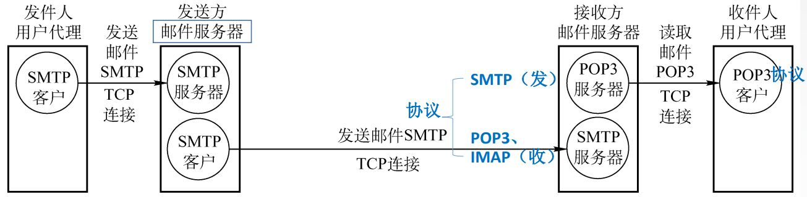

# 6.4 电子邮件

## 6.4.1 电子邮件格式

- 首部
  - From（发件人）：aye10032@gmail.com
  - To（必须填入）：tc_aye@outlook.com
  - Subject（可选）：电子邮件格式
- 主体
  - 正文内容

## 6.4.2 电子邮件组成结构

- **用户代理**
  - 为用户提供编写、发送和阅读邮件的程序
  - 例如 outlook 等
  - 将邮件发送到自身的邮件服务器
- **邮件服务器**
  - 将邮件发送到接收方的邮件服务器
  - 向发件人报告邮件传输结果
  - 可以同时充当服务器和客户
  - 基于<mark style="color:purple;">**C/S**</mark>模式
  - 使用<mark style="color:purple;">**TCP**</mark>连接实现可靠传输

## 6.4.3 SMTP 和 POP3

### 1、简单邮件传送协议 SMTP

- **SMTP 客户**：负责发送邮件的 SMTP 进程
- **SMTP 服务器**：负责接收邮件的进程
- 邮件服务器之间转发通常使用 TCP 25 端口；客户端向服务器提交邮件常用 587 端口，具体连接可使用 TLS 保护。

#### 传输过程

- **建立连接**
- 邮件发送
- 连接释放

#### MIME 与传输限制

传统 SMTP 以 7 位 ASCII 为基础。**MIME（多用途互联网邮件扩展）**通过内容类型和编码等机制支持中文、附件及多种正文格式；例如，二进制附件可编码后传输。现代 SMTP 扩展也支持更丰富的内容。服务器对邮件大小的限制取决于具体配置。

### 2、邮局协议 POP3

- 端口为 110
- POP3 本身不加密；可通过 TLS 保护连接，常见的隐式 TLS 端口为 995
- 将邮件下载至客户端，并视情况
  - 继续保留在服务器中
  - 删除服务器中的邮件

### 3、网际报文存取协议 IMAP

- 当用户 Pc 上的 IMAP 客户程序打开 IMAP 服务器的邮箱时，用户可以看到邮箱的首部
- 若用户需要打开某个邮件，该邮件内容才从服务器下载到用户的计算机上
- IMAP 可以让用户在不同的地方使用不同的计算机随时上网阅读处理邮件
- IMAP 允许只读取邮件中的某一个部分

### 4、基于万维网的电子邮件

使用浏览器登录电子邮箱来收发电子邮件

- **用户代理**
  - 浏览器
  - 通过 HTTP 或 HTTPS 与邮件服务的 Web 服务器通信
- **邮件服务器**
  - 使用供应商的邮件服务器而不是自己的
  - 邮件服务器之间的通信协议仍然为 SMTP
