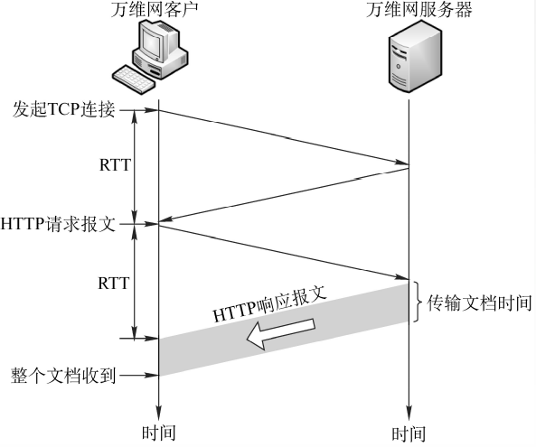
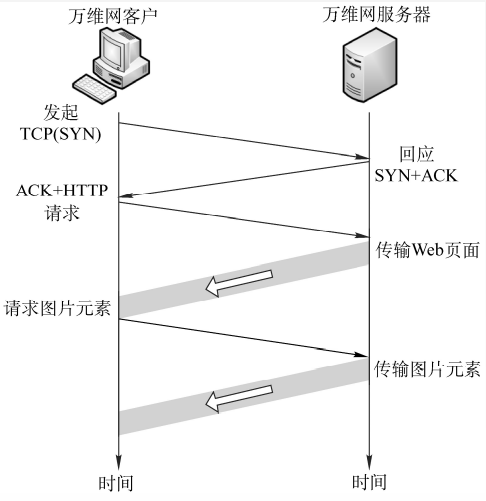
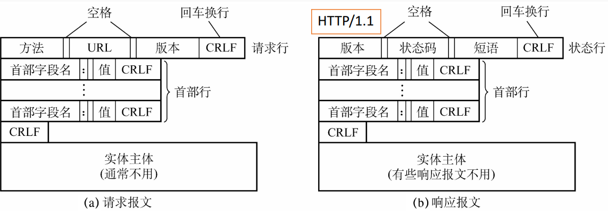

# 6.5 万维网

## 6.5.1 万维网概述

万维网（WWW）通过超链接组织资源，通常采用客户/服务器模型。浏览器使用 HTTP 请求资源，并根据内容类型处理 HTML 等文档。

- **URL（统一资源定位符）**用于定位资源，常见形式为 `协议://主机:端口/路径?查询参数#片段`。端口可省略；片段通常由浏览器处理，不随 HTTP 请求发送。
- URL 的协议和主机名不区分大小写；路径等其他部分是否区分大小写取决于服务端，不能一概而论。
- **HTML** 是描述网页结构的标记语言，**HTTP** 是客户端与服务器交换资源的应用层协议。

## 6.5.2 超文本传输协议 HTTP

HTTP 采用请求和响应模型：客户端发送方法和目标资源，服务器返回状态码、首部以及可能存在的内容。HTTP 是**无状态协议**，协议本身不要求服务器记住前一次请求；应用可以借助 Cookie 和服务端会话关联多次请求。无状态不意味着每次都要重新建立连接。

### 1、访问网页的过程

1. 浏览器解析 URL，必要时通过 DNS 查询域名对应的 IP 地址；缓存命中时可以省略查询。
2. 浏览器建立或复用连接。HTTP/1.1 和 HTTP/2 通常使用 TCP，HTTPS 还要建立 TLS 安全通道；HTTP/3 使用基于 UDP 的 QUIC。
3. 浏览器发送 HTTP 请求，服务器返回响应。页面引用的图片、脚本等资源可能触发更多请求。
4. 浏览器处理响应并渲染页面；连接可供后续请求复用，不必在每次响应后立即关闭。

### 2、HTTP/1.1 的连接方式

- **非持久连接**：每个请求使用单独的 TCP 连接。忽略 DNS、TLS 和服务器处理时间时，从建立 TCP 连接到收到响应首字节约需 2 个 RTT，再加上响应内容传输时间。RTT 是一个往返时间。
- **持久连接**：多个请求可以复用同一条连接，HTTP/1.1 默认使用持久连接。
- **流水线**：客户端可以不等前一个响应就发送后续请求，但服务器仍须按请求顺序返回响应。前面的响应慢会阻塞后面的响应，因此实际使用有限。





### 3、HTTP 报文、方法与状态码

下图及以下文本格式以 HTTP/1.1 为例。报文由起始行、首部、空行和可选的消息体组成；HTTP/2、HTTP/3 使用二进制分帧，而不是直接传输这种文本格式。



```http
GET /notes HTTP/1.1
Host: example.com
Accept: text/html

HTTP/1.1 200 OK
Content-Type: text/html; charset=utf-8

<html>...</html>
```

请求行包括方法、请求目标和版本；响应状态行包括版本、状态码和原因短语。首部描述目标主机、内容类型等信息，消息体可携带提交的数据或响应内容。

| 方法 | 常见用途 | 安全 | 幂等 |
| --- | --- | --- | --- |
| GET | 获取资源 | 是 | 是 |
| HEAD | 获取与 GET 对应的响应首部，不返回响应内容 | 是 | 是 |
| POST | 提交数据或触发处理 | 否 | 不保证 |
| PUT | 创建或替换目标资源 | 否 | 是 |
| PATCH | 对资源进行部分修改 | 否 | 不保证 |
| DELETE | 删除目标资源 | 否 | 是 |

**安全**指请求的预期语义是只读；**幂等**指重复发送相同请求与发送一次的预期效果相同，响应不一定相同。日志等副作用不影响这一协议语义，但实际接口仍需正确实现，不能仅凭方法名保证业务安全或放心重试。

常见状态码按首位数字分组：

- `1xx`：请求处理中，如 `100 Continue`。
- `2xx`：请求成功，如 `200 OK`、`201 Created`、`204 No Content`。
- `3xx`：重定向或缓存相关，如 `301` 永久重定向、`302` 临时重定向、`304 Not Modified` 表示缓存仍可使用。
- `4xx`：客户端请求存在问题，如 `400` 请求错误、`401` 缺少有效身份认证、`403` 拒绝访问、`404` 资源未找到。
- `5xx`：服务端处理出错，如 `500` 服务器内部错误、`502` 网关收到无效响应、`503` 服务暂不可用。

### 4、Cookie 与缓存

服务器可通过 `Set-Cookie` 让浏览器保存 Cookie，浏览器之后按作用域和属性规则在请求中携带 `Cookie`。Cookie 可保存会话标识，具体用户状态也可以保存在服务端；`HttpOnly` 可限制脚本读取，`Secure` 要求通过安全连接发送，`SameSite` 可限制跨站发送。

缓存用于减少重复传输：响应中的 `Cache-Control: max-age=...` 指定可复用的时间；`no-cache` 表示复用前需要验证，`no-store` 表示不应存储。缓存过期后，客户端可用 `If-None-Match` 携带 ETag，或用 `If-Modified-Since` 携带修改时间进行条件请求；资源未变化时，服务器可返回 `304`，客户端复用已有内容。

## 6.5.3 HTTPS

HTTPS 是通过安全传输承载 HTTP：HTTP/1.1 或 HTTP/2 通常是 HTTP over TLS over TCP；HTTP/3 则由 QUIC 集成 TLS 1.3。默认端口分别为 HTTP 的 80 和 HTTPS 的 443，实际端口可以配置。

TLS 提供数据保密性、完整性和服务端身份认证，也可按需认证客户端。以常见的 TLS 1.3 证书握手为例：

1. 客户端发送支持的参数和密钥交换信息，服务器选择参数并返回相应信息。
2. 服务器发送证书及握手签名；客户端验证证书链、有效期和域名等，并验证签名，确认对方持有对应私钥。
3. 双方根据密钥交换结果派生会话密钥，完成握手后使用对称加密保护应用数据。

证书用于身份认证，并不意味着用证书公钥加密所有 HTTP 数据。HTTPS 也不保证网站内容可信；连接终止于反向代理等中间节点时，后续链路是否加密还取决于部署。

## 6.5.4 HTTP 版本对比

| 版本 | 传输与报文 | 主要特点和限制 |
| --- | --- | --- |
| HTTP/1.0 | 通常基于 TCP，文本报文 | 默认非持久连接，也可通过扩展实现连接复用。|
| HTTP/1.1 | 通常基于 TCP，文本报文 | 默认持久连接；流水线响应须按序返回，可能发生应用层队头阻塞。|
| HTTP/2 | 基于 TCP，二进制分帧 | 一条连接上多路复用多个流，使用 HPACK 压缩首部；TCP 丢包时，字节流的顺序交付可能阻塞其他流。|
| HTTP/3 | 基于 QUIC，QUIC 通常承载于 UDP | 多个 QUIC 流独立交付，某流丢失的数据通常不会阻塞其他流的交付；仍共享连接级拥塞控制，丢包仍会影响整体性能。使用 QPACK 压缩首部。|

HTTP/2 和 HTTP/3 保留 HTTP 的方法、状态码等语义，主要改变传输方式。QUIC 在 UDP 之上实现可靠传输、流量控制和拥塞控制，并集成 TLS 1.3；网络限制 UDP 时，客户端可能回退到基于 TCP 的 HTTP 版本。

参考：[HTTP 语义 RFC 9110](https://www.rfc-editor.org/rfc/rfc9110.html) · [HTTP 缓存 RFC 9111](https://www.rfc-editor.org/rfc/rfc9111.html) · [HTTP/2 RFC 9113](https://www.rfc-editor.org/rfc/rfc9113.html) · [HTTP/3 RFC 9114](https://www.rfc-editor.org/rfc/rfc9114.html) · [TLS 1.3 RFC 8446](https://www.rfc-editor.org/rfc/rfc8446.html)
