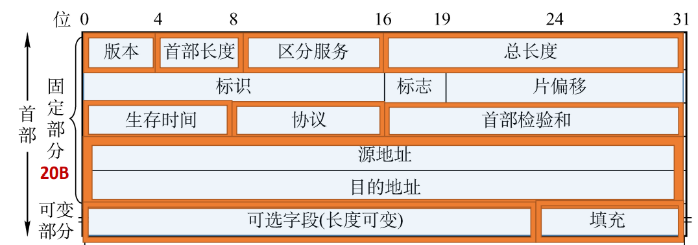
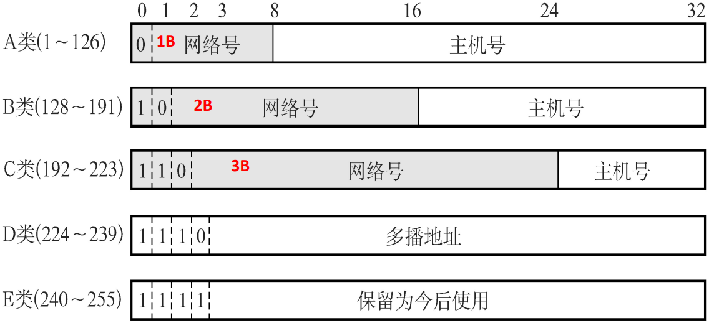
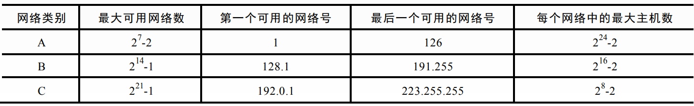
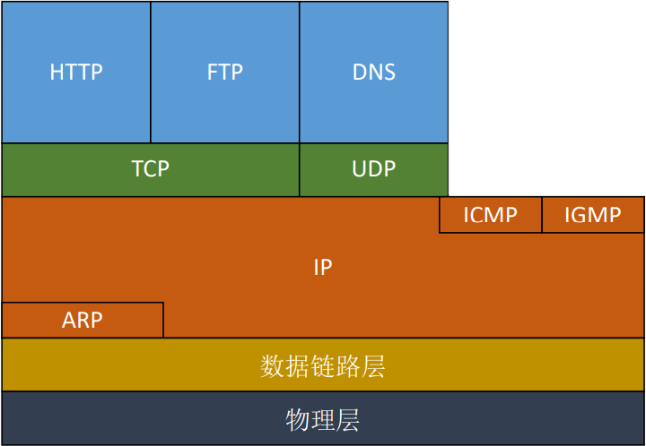
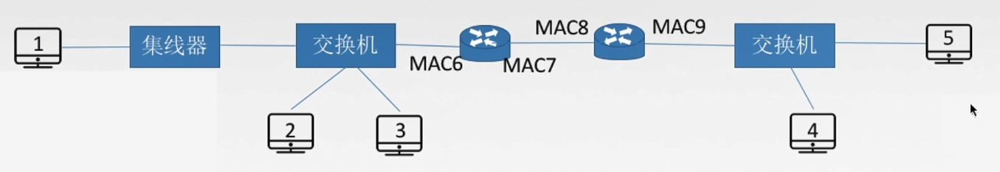
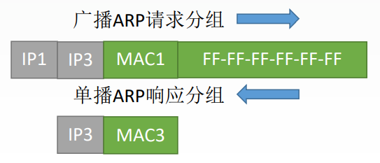
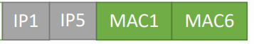
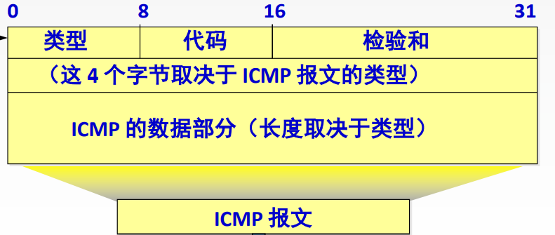
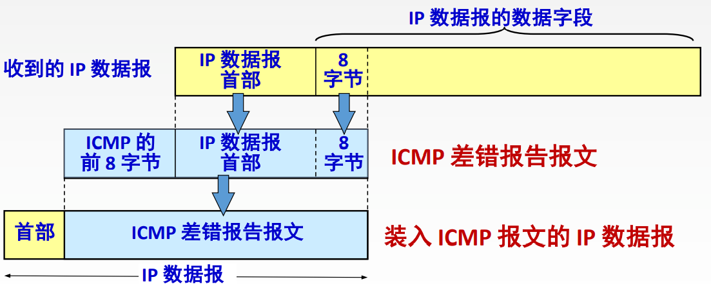

# 4.2 IPV4

## 4.2.1 IP 分组

### 1、IP 数据报的格式

- **版本**（4bit）：IPV4/IPV6
- **首部长度**（4bit）：标识首部的长度
  - <mark style="color:orange;">**单位是 4B**</mark>
  - 最小为 5（0101）：20B
  - 最大为 15（1111）：60B
- **区分服务**（8bit）：指示期望获得哪 种类型的服务
- **总长度**（16bit）：整个数据报（首部+数据）的长度
  - <mark style="color:orange;">**单位是 1B**</mark>
  - 最小为 20 B（无数据且首部无选项）
  - 最大为 65535 B；链路 MTU 可能更小
- **标识**（16bit）：同一数据报的分片使 用同一标识
- **标志**（3bit）
  - 最高位无用
  - 中间位 DF（Don’t Fragment）
    - DF=1：禁止分片
    - DF=0：允许分片
  - 最低位位 MF （More Fragment）
    - MF=1：后面还有分片
    - MF=0：最后一个分片
- **片偏移**（13bit）：指出较长分组分片后，某片在原分组中的相对起始位置
  - <mark style="color:orange;">**单位是 8B**</mark>
- **生存时间**（8bit）：IP 分组的保质期
  - 每经过一个路由器-1
  - 变成 0 时丢弃
- **协议**（8bit）：数据部分（即传输层报文段）所采用的协议
  - TCP：6
  - UDP：17
- **首部检验和**（16bit）：检验首部信息
- **源地址、目的地址**（各 32bit）：来源和目标的 IP 地址
- 可选字段（0~40B）：支持排错、测量以及安全等措施
- **填充**：保证首部长度为 4B 的整数倍

### 2、IP 数据报分片

**最大传送单元 MTU**：链路层数据帧可封装数据的上限。常见以太网 MTU 为 1500 字节（B）。

当下一跳链路的 MTU 为 1500 B 时，单个通过该链路的 IP 数据报或分片（首部加数据）不能超过 1500 B。IP 数据报本身的总长度上限是 65535 B。

片偏移量为该片数据在原始数据部分中的起始字节位置除以 8；每个分片都有自己的 IP 首部。

::: danger

**除最后一片外，每个分片的数据部分长度必须是 8 B 的整数倍**；首部不计入此限制，最后一片的数据长度可以不是 8 B 的整数倍。

:::

::: info

例：已知数据报首部为 20B，数据部分为 3800B，将其分为长度不超过 1420B 的数据报片

每一片的**数据部分**长度$=1420 - 20 = 1400$

分为三片：$1400+1400+1000 = 3800$

分别的偏移量：

- 第一片：$0 \div 8 = 0$
- 第二片：$1400 \div 8 = 175$
- 第三片：$2800\div 8 = 350$

:::

## 4.2.2 IPV4 地址

### 1、分类的 IP 地址

#### （1）特殊的 IP 地址

|     IP 地址      | 作为源地址 | 作为目的地址 |                    用途                    |
| :-------------: | :--------: | :----------: | :----------------------------------------: |
|     0.0.0.0     |     ✔      |      ❌       | 本网络范围内表示主机，路由表内表示默认路由 |
|     0.0.0.X     | 历史用途 | 历史用途 | 历史上的本网络地址表示，实际使用应以当前规范和场景为准 |
| 255.255.255.255 |     ❌      |      ✔       |               本网络广播地址               |
|     X.X.X.0     |     ❌      |      ❌       |             表示某一个**网络**             |
|    X.X.X.255    |     ❌      |      ✔       |             对特定网络进行广播             |
|    127.X.X.X    |     ✔      |      ✔       |                  本地环回                  |

地址是否为网络地址或广播地址取决于子网掩码，不能只看最后一段是否为 0 或 255；/31 等特殊前缀见下文。

#### （2）私有 IP 地址

| 地址类别 |              地址范围               | 网段个数 |
| :------: | :---------------------------------: | :------: |
|   A 类    |   **10**.0.0.0~**10**.255.255.255   |    1     |
|   B 类    |  **172.16**.0.0~**172.31**.255.255  |    16    |
|   C 类    | **192.168.0**.0~**192.168.255**.255 |   256    |

#### （3）分类地址与主机数量

分类编址是早期的划分方式：A、B、C 类默认网络前缀分别为 /8、/16、/24。实际子网的地址范围和主机数量应以题目给出的掩码为准；通常有 $2^{\text{主机位数}} - 2$ 个可用主机地址，/31 和 /32 需单独判断。

### 2、网络地址转换 NAT

NAT 路由器在转发时转换 IP 地址；常见的端口地址转换（NAPT）还转换端口，以映射表区分多个内网连接，让多台设备共享外部地址。私有地址可以在私有网络中作为源或目的地址，但不能直接在公网路由。外部主动访问内网通常需要端口映射等配置。

## 4.2.3 子网划分与子网掩码

### 1、子网划分

#### 分类 IP 地址的缺点

- IP 地址空间利用率低
- 两级 IP 地址不够灵活

#### 子网划分

将原本 IP 地址的主机号再次进行划分，得到子网号+新的主机号

- 现代 CIDR 编址允许全 0 和全 1 的子网号。
- 普通广播子网中，主机位全 0 表示网络地址，全 1 表示定向广播地址，不分配给普通主机；/31 点对点链路和 /32 有特殊用途，见下文。

内部子网可以对外聚合为较短前缀，是否隐藏细分路由取决于路由配置。

#### 子网划分的意义

- 增加子网的数量
- 减小广播域
- 减少每个子网的地址数量
- 提高 IP 的利用率
- 在原有地址块内增加子网数量，不增加地址总量

### 2、子网掩码

将网络号的部分全部表示为 1，主机号的部分全部表示为 0，即得到子网掩码

- 对于两级 IP 地址（未划分子网），网络号部分为 1，即为子网掩码
- 对于三级 IP 地址（划分子网），网络号+子网号的部分为 1，即为子网掩码

#### （1）IP 地址与子网地址的计算

将 IP 地址与子网掩码逐位<mark style="color:purple;">**相与**</mark>，即得到网络地址

::: tip

**相与**：两个对应的位均为 1，结果为 1；否则结果为 0

:::

::: info

例 1：已知 IP 地址是 141.14.72.24，子网掩码是 255.255.192.0，求网络地址；如果子网掩码是 255.255.224.0，求网络地址
$$
\begin{align*}
72 &= 01001000\\
192&= 11000000\\
result & = 01000000 = 64
\end{align*}
$$
故网络地址为 141.14.64.0
$$
\begin{align*}
72 &= 01001000\\
224&= 11100000\\
result & = 01000000 = 64
\end{align*}
$$
网络地址为 141.14.64.0

:::

#### （2）计算 IP 所在的子网范围

IPv4 地址共 32 位。`/前缀长度` 表示网络位数，剩下的是主机位。例如 `/27` 有 27 位网络位、5 位主机位。**网络地址是 IP 与掩码逐位相与的结果**；普通广播子网中，主机位全置 1 得到广播地址，两者之间是可用主机范围。

总地址数为 $2^{32-前缀长度}$；普通子网的可用主机数通常是总数减 2。这个公式不适用于下文的 /31 点对点链路和 /32。

**二进制法：以 `192.168.10.96/27` 为例**

前 24 位在前三段，第 4 段的前 3 位是网络位，后 5 位是主机位。`96 = 01100000`，按边界拆为 `011 | 00000`：

| 地址 | 第 4 段 | 完整地址 |
| --- | --- | --- |
| 网络地址，主机位全 0 | `01100000` = 96 | `192.168.10.96` |
| 广播地址，主机位全 1 | `01111111` = 127 | `192.168.10.127` |
| 可用主机范围 | 网络地址加 1 至广播地址减 1 | `192.168.10.97` 至 `192.168.10.126` |

本例有 $2^5=32$ 个地址，通常可分配 30 个。题目中的 `96` 主机位恰好全为 0，因此是网络地址，不是普通主机地址。

**步长法：考试速算**

1. 找到掩码中网络位和主机位的分界字节，也就是第一个小于 255 的字节；该字节前面的地址段保持不变。
2. 用 $256 - 该字节的掩码值$ 算出该字节的步长。将 IP 对应段向下取到不超过它的最大步长倍数，得到该段的起点；终点为起点加步长减 1。
3. 网络地址在分界字节之后全部填 `0`；广播地址在分界字节之后全部填 `255`。普通子网的可用范围为网络地址加 1 至广播地址减 1。

| 分界字节的网络位 | 掩码值 | 该字节的步长 |
| --- | --- | --- |
| 0 | 0 | 256 |
| 1 | 128 | 128 |
| 2 | 192 | 64 |
| 3 | 224 | 32 |
| 4 | 240 | 16 |
| 5 | 248 | 8 |
| 6 | 252 | 4 |
| 7 | 254 | 2 |

前缀恰好为 `/8`、`/16`、`/24` 时，分界落在字节边界：已占满的字节保持不变，后续字节网络地址填 `0`、广播地址填 `255`。例如 `/24` 的网络地址保留前三段，末段为 `0`；广播地址末段为 `255`。`/0` 覆盖全部 IPv4 地址，`/32` 只有一个地址，单独处理。

注意：**该字节的步长不一定等于整个子网的地址总数**。例如 `/22` 的第 3 段步长是 4，但第 4 段也有 256 种取值，因此总地址数为 $4 \times 256 = 1024$。

**跨字节例题**

| IP / 前缀 | 掩码与分界段 | 段内区间 | 网络地址 | 广播地址 | 可用主机范围 |
| --- | --- | --- | --- | --- | --- |
| `172.16.45.100/22` | `255.255.252.0`，第 3 段步长 4 | `44` 至 `47` | `172.16.44.0` | `172.16.47.255` | `172.16.44.1` 至 `172.16.47.254` |
| `10.75.120.5/12` | `255.240.0.0`，第 2 段步长 16 | `64` 至 `79` | `10.64.0.0` | `10.79.255.255` | `10.64.0.1` 至 `10.79.255.254` |

例如第一题：`45` 向下对齐到 4 的倍数 `44`，终点为 `44 + 4 - 1 = 47`；第 4 段分别填 `0` 和 `255`。

**易错点与检查**

- 求的是整个地址块还是可用主机范围：前者包含网络地址和广播地址，后者在普通子网中不包含。
- 输入地址不一定是主机地址。比如 `192.168.10.96/27` 本身是网络地址，而 `192.168.10.127/27` 是广播地址。
- 网络地址加 1、广播地址减 1 是对整个 IPv4 地址运算，不是固定只改最后一段；还需结合实际地址用途判断能否分配。
- 复核时确认输入地址位于算出的区间内，网络地址按掩码与运算后不变，且总地址数为 $2^{32-前缀长度}$。

**特殊前缀**：在支持 [RFC 3021](https://www.rfc-editor.org/rfc/rfc3021.html) 的 `/31` 点对点链路上，两个地址均可作为链路端点，不按普通子网扣除网络和广播地址；`/32` 表示单个地址，常用于主机路由，不套用减 2 公式。

**练习：先独立计算网络地址、广播地址和可用范围**

1. `192.168.1.130/26`
2. `192.168.2.63/27`
3. `172.20.19.8/20`
4. `10.24.17.99/16`

查看答案

| 题目 | 网络地址 | 广播地址 | 可用主机范围 |
| --- | --- | --- | --- |
| 1 | `192.168.1.128` | `192.168.1.191` | `192.168.1.129` 至 `192.168.1.190` |
| 2 | `192.168.2.32` | `192.168.2.63` | `192.168.2.33` 至 `192.168.2.62`；题目地址是广播地址 |
| 3 | `172.20.16.0` | `172.20.31.255` | `172.20.16.1` 至 `172.20.31.254` |
| 4 | `10.24.0.0` | `10.24.255.255` | `10.24.0.1` 至 `10.24.255.254` |

### 3、使用子网时的分组转发

路由表的表项通常包含目的网络前缀和出接口或下一跳。路由器根据分组的目的 IP 地址查找匹配前缀：将目的地址与表项掩码相与，结果等于表项网络地址即为匹配。多个表项匹配时，选择最长前缀；`/32` 主机路由是最具体的匹配，`0.0.0.0/0` 默认路由可在没有更具体匹配时使用。

匹配直连网络时通过相应接口交付；匹配下一跳路由时转发给下一跳。没有可用路由时丢弃分组，并可按规则返回 ICMP 目的不可达。转发时 TTL 减 1，减至 0 时丢弃，并可按规则返回 ICMP 时间超过。

### 4、无分类域间路由选择（CIDR）

#### （1）无分类编址

CIDR 不依赖 A、B、C 类的固定边界，而是使用可变长度的网络前缀；在内部管理中仍可将前缀进一步划分为子网。

**CIDR 记法**：使用一定长度的位代表<mark style="color:purple;">**网络前缀**</mark>，表示为 IP 地址/网络前缀**位数**，如 128.14.32.0/20

网络前缀的位数是可变的，<mark style="color:orange;">**网络前缀相同**</mark>的地址合称为一个<mark style="color:purple;">**地址块**</mark>。

::: info

例：128.14.35.7/20 是某 CIDR 地址块中的一个地址，分析这个地址块

二进制表示：<mark style="color:red;">**10000000 00001110 0010**</mark>0011 00000111

地址块内地址总数：$2^{12} = 4096$；普通子网通常可用主机地址为 4094 个。

最小地址：<mark style="color:red;">**10000000 00001110 0010**</mark>0000 00000000（128.14.32.0）

最大地址：<mark style="color:red;">**10000000 00001110 0010**</mark>1111 11111111（128.14.47.255）

所在地址块：<mark style="color:red;">**10000000 00001110 0010**</mark>0000 00000000（128.14.32.0）

地址掩码：<mark style="color:red;">**11111111 11111111 1111**</mark>0000 00000000（255.255.240.0）

:::

#### （2）构成超网

将多个子网聚合成一个较大的子网，叫做<mark style="color:purple;">**构成超网**</mark>，或<mark style="color:purple;">**路由聚合**</mark>

::: info

例：将 206.1.0.0/17 与 206.1.128.0/17 构成超网
$$
\begin{align*}
206.1.0.0 &= 11001110\ 00000001\ 00000000\ 00000000\\
206.1.128.0 &= 11001110\ 00000001\ 10000000\ 00000000\\
result & = 11001110\ 00000001\ 00000000\ 00000000
\end{align*}
$$
所构成的超网为 206.1.0.0/16

:::

#### （3）最长前缀匹配

使用 CIDR 时，通过跟网络掩码按位相与查找路由表，可能得到几个匹配结果，选择具有**最长网络前缀**的作为下一跳路由

- 前缀越长
- 地址块越小
- 路由越具体

## 4.2.4 ARP、DHCP 和 ICMP

### 1、ARP 协议

#### （1）发送数据的过程

- **应用层**：产生报文
- **传输层**：根据大小将报文分为报文段
- **网络层**：将报文段加上 IP 地址（源主机和目的主机），形成（IP 数据报）分组
- **数据链路层**：将分组加上 MAC 地址（源主机和**目的主机**）和 FCS
- **物理层**：通过数字或模拟方式传输

#### （2）网络层数据传输的具体过程

**解决下一跳走哪的问题**

**ARP 高速缓存**：每台主机中都有的，IP 地址与 MAC 地址的映射

在链路层传输数据报分组时，必须以 MAC 地址的形式传递，因此需要使用 ARP 协议来获得目的主机的 MAC 地址，过程如下：

##### 1）查找 ARP 高速缓存

首先查找本机的 ARP 缓存中有没有目的 IP 对应的 MAC 地址，如果有则直接填入

##### 2）当目的主机在局域网内时

- 发送的请求分组中目的 MAC 地址为全 1，表示广播分组
- 返回的响应分组中包括了目的 MAC 地址，直接填入即可

##### 3）当目标主机不在本网络时

- 通过本机的子网掩码和目标地址做与运算，发现目标 IP 不在一个网段内
- 目的 MAC 地址设为默认网关（本网络出口路由器）的 MAC 地址
  - 获取默认网关的 MAC 地址的方法仍然为通过 ARP 协议
- 之后的传输交由路由器处理

##### 4）由路由器传到下一个路由器

- 源 IP 和目的 IP 不变
- MAC 地址改为相应的路由器 MAC 地址

##### 5）由路由器到本网络内主机

- 最后一跳路由器通过 ARP 获取目的主机的 MAC 地址
- IP 地址仍然为最初的地址
- MAC 地址为路由器地址和获得的目的主机 MAC 地址

#### （3）ARP 协议

**功能**：完成主机或路由器 IP 地址到 MAC 地址的映射

过程

- 检查 ARP 高速缓存
  - 有对应表项则写入 MAC 帧
  - 没有则用目的 MAC 地址为 FF-FF-FF-FF-FF-FF 的帧封装并广播 ARP 请求分组
- 目的主机收到请求后就向源主机单播一个 ARP 响应分组
- 源主机收到后将此映射写入 ARP 缓存（具体有效时间取决于系统配置）

::: danger

以太网帧的源和目的**MAC 地址**：上、下一条的 MAC 地址

IP 数据报的源和目的 **IP 地址**：通常端到端保持不变；经过 NAT 时可能被改写。

:::

### 2、DHCP 协议

**动态主机配置协议 DHCP**：

- 是<mark style="color:orange;">**应用层**</mark>协议
- 使用客户/服务器方式
- 客户端与服务端按阶段使用广播或单播；跨网段时可由 DHCP 中继转发
- 基于<mark style="color:purple;">**UDP**</mark>

**DHCP 协议的过程：**

- 主机广播<mark style="color:purple;">**DHCP 发现**</mark>报文
  - 试图找到网络中的 DHCP 服务器
- DHCP 服务器发送<mark style="color:purple;">**DHCP 提供**</mark>报文
  - 服务器拟分配给主机一个 IP 地址及相关配置
  - 客户端选择一个提供
- 主机广播<mark style="color:purple;">**DHCP 请求**</mark>报文
  - 主机向服务器请求提供 IP 地址
- DHCP 服务器发送<mark style="color:purple;">**DHCP 确认**</mark>报文
  - 正式将 IP 地址分配给主机

### 3、ICMP 协议

在网络层，使用<mark style="color:purple;">**网际控制报文协议（ICMP）**</mark>来让主机和路由器报告差错和异常情况。

ICMP 报文在首部的类型字段中表明此条报文的种类。

#### （1）ICMP 差错报文

##### 差错报文的类型

- **终点不可达**：无法交付
- **源点抑制**（已取消）：拥塞丢数据
- **时间超过**：报文生存时间 TTL=0，丢弃部分已收到的数据报片
- **参数问题**：首部字段有问题
- **改变路由（重定向）**：有更好的路由

##### 差错报文的组成

ICMP 差错报文本身是一个 IP 数据报

##### 不发送差错报文的情况

- 对 ICMP 差错报告报文不再发送 ICMP 差错报告报文
- 对第一个分片的数据报片的所有**后续数据报片**都不发送 ICMP 差错报告报文
- 对具有**组播地址**的数据报都不发送 ICMP 差错报告报文
- 对具有**特殊地址**（如 127.0.0.0 或 0.0.0.0）的数据报不发送 ICMP 差错报告报文

#### （2）ICMP 询问报文

- **回送请求和回答报文**：能否 PING 通
- **时间戳请求和回答报文**：获得时间戳
- **掩码地址请求和回答报文**
- **路由器询问和通告报文**

#### （3）ICMP 应用

- PING：测试两个主机之间的连通性，使用了<mark style="color:purple;">**ICMP 回送请求和回答报文**</mark>
- traceroute：跟踪一个分组从源点到终点的路径，使用了<mark style="color:purple;">**ICMP 时间超过差错报告报文**</mark>
  - 发送一连串的报文，TTL 依次设置为 1、2、3……
  - 每到一个新的路由，就有一个数据报生命周期结束
  - 不断接受差错报告报文
