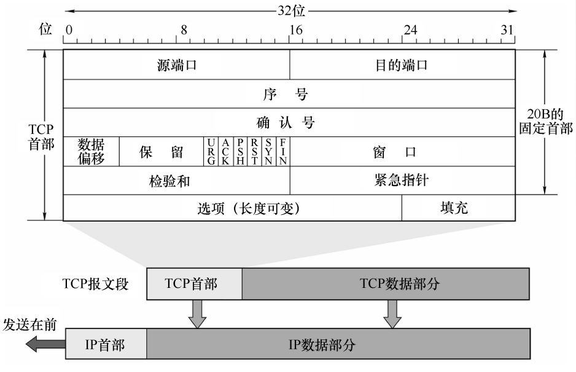
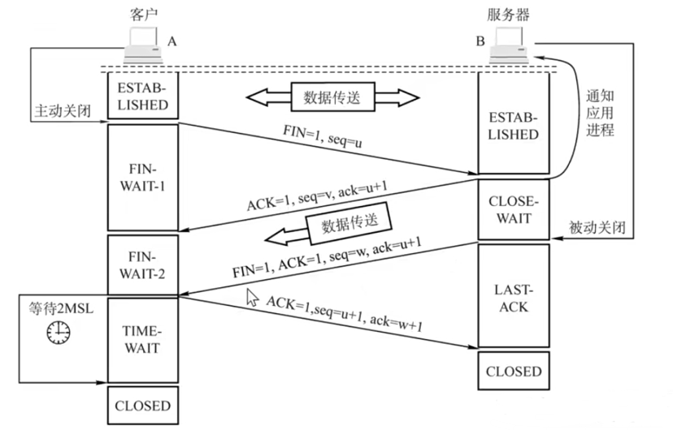
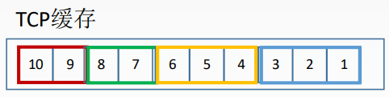
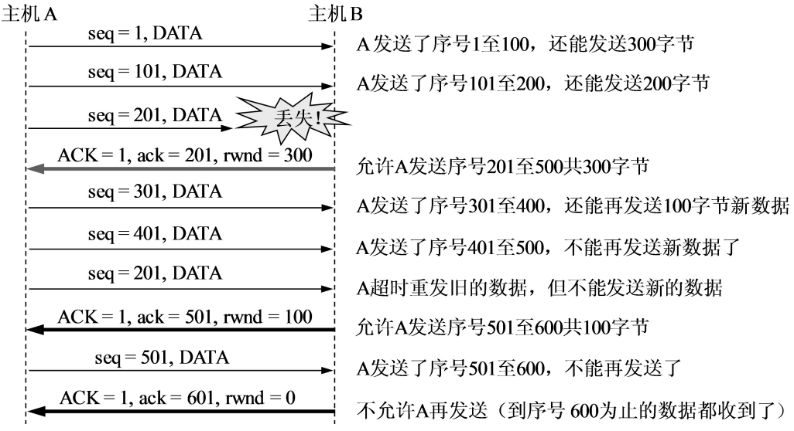
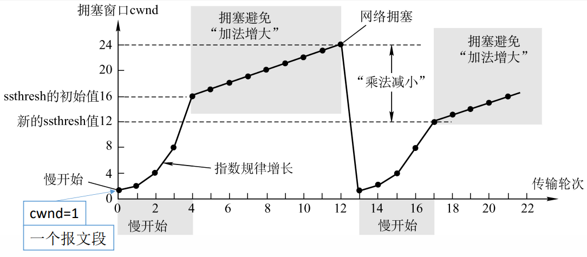
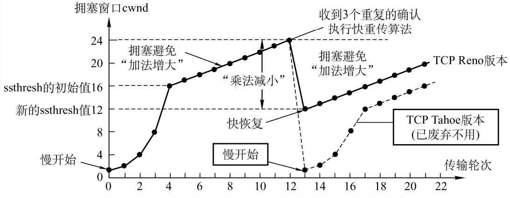

# 5.3 TCP 协议

**TCP 用连接管理、字节编号、确认重传和窗口控制，在可能丢包、乱序的网络上提供可靠的字节流传输。**

## 5.3.1 TCP 协议的特点

- **面向连接**：先建立逻辑连接，维护序号、窗口和缓存等状态；不预留专用物理线路。
- **点对点**：一条连接只有两个端点，不支持广播、组播。通常用源 IP、源端口、目的 IP、目的端口四元组识别连接。
- **可靠交付**：通过校验、编号、确认和重传，实现按序、去重的交付。故障仍可能导致传输失败；TCP 确认数据，不等于对端应用已完成业务处理。
- **全双工**：双方可以同时收发，两个方向分别维护序号和窗口。
  - 发送缓存：待发送数据，以及已发送但尚未确认、需要保留以便重传的数据。
  - 接收缓存：已按序收到但应用尚未读取的数据，以及暂存的乱序数据。
- **面向字节流**：按字节编号，不保留应用消息边界。一次写入可以分段，多次写入也可以被一次读取。

**粘包、拆包**：比如依次发送 `hello`、`world`，接收方可能一次读到 `helloworld`，也可能分几次读完。应用需用固定长度、分隔符或“长度字段＋消息体”识别消息边界。

## 5.3.2 TCP 报文段格式

### 1、主要字段

| 字段 | 长度 | 记忆要点 |
| --- | --- | --- |
| 源端口、目的端口 | 各 16 位 | 标识双方应用端点 |
| 序号 `seq` | 32 位 | 本段第一个数据字节的编号 |
| 确认号 `ack` | 32 位 | 期望收到的下一个字节编号，此前字节已连续收到 |
| 数据偏移 | 4 位 | 首部长度，单位为 4 B；最短 20 B，最长 60 B |
| 窗口 | 16 位 | 通告本端接收窗口，约束对方发送；未扩大时为 0～65535 B |
| 校验和 | 16 位 | 校验首部、数据和 IP 伪首部；伪首部中的协议号为 6 |
| 紧急指针 | 16 位 | URG＝1 时有效；相对 `seq` 的偏移，指向紧急数据之后的第一个字节 |
| 选项与填充 | 可变 | MSS、窗口扩大、时间戳、SACK 等；填充使首部长度为 4 B 的整数倍 |

伪首部只参与校验计算，不是 TCP 首部中实际增加的一段内容。**MSS**是单个报文段的数据大小上限，不含 TCP、IP 首部；MTU 为 1500 B、IPv4 和 TCP 均无选项时，数据上限为 1460 B。

### 2、六个常考标志位

每个标志各占 1 位。大写 ACK 是标志，小写 `ack` 是确认号数值。

| 标志 | 含义 |
| --- | --- |
| SYN，同步 | 建立连接，同步初始序号 |
| ACK，确认 | 确认号字段有效 |
| FIN，结束 | 本方向已无更多数据，仍可接收另一方向的数据 |
| RST，复位 | 拒绝或中止连接，与正常 FIN 关闭不同 |
| PSH，推送 | 请求及时把已收到的数据交给应用；不标记消息边界，不保证一次 `recv()` 读完，也不能越过丢失字节 |
| URG，紧急 | 紧急指针有效；不代表独立的高优先级传输通道 |

### 3、序号计算

**下一个序号＝本次序号＋数据字节数＋SYN 占用数＋FIN 占用数。** SYN、FIN 各占一个序号；纯 ACK 不占序号。

- `seq=1001`，携带 500 B：覆盖 1001～1500；此前无缺口时，返回 `ack=1501`。
- **回绕**：32 位序号用到最大值 4294967295 后，从 0 继续。比如从 4294967294 发送 4 B，编号是 4294967294、4294967295、0、1，收齐后确认号为 2；不是重新建立连接。

补充：窗口扩大、时间戳与首部规范

窗口扩大选项在 SYN 阶段协商，用移位因子突破 65535 B 的窗口限制；SYN 自身的窗口字段不缩放。时间戳可辅助 RTT 测量，并防止旧重复报文干扰。现代首部还包含用于显式拥塞通知 ECN 的 ECE、CWR 等标志。

紧急指针历史实现存在差异，新应用通常不应使用紧急机制。首部与紧急指针见 [RFC 9293](https://www.rfc-editor.org/rfc/rfc9293.html#section-3.1)，窗口扩大、时间戳见 [RFC 7323](https://www.rfc-editor.org/rfc/rfc7323.html)。

## 5.3.3 TCP 连接管理

### 1、三次握手

主动发起的一方是客户端，被动监听的一方是服务器。设初始序号分别为 $x$、$y$，前两次握手不携带应用数据。

| 次序 | 方向与字段 | 状态变化 |
| --- | --- | --- |
| ① | 客户端 → 服务器：SYN＝1，ACK＝0，`seq=x`，确认号无效 | 客户端进入 SYN-SENT |
| ② | 服务器 → 客户端：SYN＝1，ACK＝1，`seq=y`，`ack=x+1` | 服务器进入 SYN-RECEIVED，维护半连接状态 |
| ③ | 客户端 → 服务器：SYN＝0，ACK＝1，`seq=x+1`，`ack=y+1` | 客户端进入 ESTABLISHED；服务器收到有效确认后也进入该状态 |

**三次的原因**：双方交换初始序号，并分别确认自己的 SYN 已被对方收到，避免仅凭延迟的旧 SYN 就认定连接完整建立。第三次握手可携带数据；若不携带，纯 ACK 不消耗序号。缓存和连接对象的具体分配时机取决于实现。

**SYN 洪泛**：大量发送 SYN 却不完成握手，耗尽半连接队列等资源。SYN cookies 把可验证信息编码进服务器初始序号，减少保存半连接状态的需要；不能解决任意规模的攻击。

### 2、四次挥手

任一方都可主动关闭。设 A 主动关闭，FIN 不带数据，随后不再发送数据。

| 次序 | 方向与字段 | 状态变化 |
| --- | --- | --- |
| ① | A → B：FIN＝1，`seq=u` | A：FIN-WAIT-1 |
| ② | B → A：ACK＝1，`seq=v`，`ack=u+1` | B：CLOSE-WAIT；A 收到确认后：FIN-WAIT-2 |
| ③ | B → A：FIN＝1，ACK＝1，`seq=w`，`ack=u+1` | B 发完剩余数据，进入 LAST-ACK |
| ④ | A → B：ACK＝1，`seq=u+1`，`ack=w+1` | A：TIME-WAIT；B 收到确认后：CLOSED |

**半关闭**：A 发完了，B 仍可以向 A 发送数据，因此 $w$ 不一定等于 $v$。双方发送方向独立关闭，通常需要四个报文段；若 B 已无数据，ACK 和 FIN 可合并。

**TIME-WAIT 等待 2MSL 的作用**：

- 最后一个 ACK 丢失时，仍能再次确认对方重传的 FIN。
- 等待旧重复报文消失，减少它们对后续相同四元组连接的干扰。

MSL 是报文段最大生存时间，2MSL 不固定等于“两分钟”；TIME-WAIT 通常出现在正常主动关闭方，不专属于客户端。

追问：握手丢包与 CLOSE-WAIT 过多

第一次 SYN 丢失：客户端超时重传。第二次 SYN＋ACK 丢失：服务器重传，客户端也可能重传 SYN。第三次纯 ACK 丢失：服务器通常重传 SYN＋ACK，引出客户端再次确认；随后携带有效确认号的数据也可能完成确认。纯 ACK 本身通常不单独启动重传计时器。

CLOSE-WAIT 过多时，优先检查本端应用是否漏关连接；TIME-WAIT 较多则先看主动关闭和短连接频率。TCP Fast Open 可允许 SYN 携带数据，属于扩展机制。SYN cookies 的缓解机制与局限见 [RFC 4987](https://www.rfc-editor.org/rfc/rfc4987.html)。

## 5.3.4 TCP 可靠传输

**校验检测差错，序号定位数据，确认报告接收进度，重传补齐缺口。**

- **累计确认**：`ack=k` 表示期望字节 $k$，此前字节已连续收到；即使后面数据到了，也不能越过缺口确认。
- **捎带确认**：反向发送数据时，同时携带确认号并设置 ACK＝1；没有反向数据也能发送纯 ACK。
- **超时重传**：超过 RTO 仍未得到确认，就重传。RTT 是实测往返时间，SRTT 是其平滑估计，RTO 是结合估计与波动设置的超时阈值。
- **RTO 太短**会误重传，太长会延误丢包恢复；TCP 自适应估计 RTO，超时后采用指数退避。
- **快重传**：经典算法收到三个重复 ACK，就重传推测丢失的段，不等 RTO 到期。乱序也可能造成重复 ACK，不能把它当作丢包的绝对证明。
- **SACK，选择确认**：报告已收到的不连续字节区间，帮助有针对性地重传；累计确认仍不能越过缺口，应用仍按序读取。

**快重传短例子**：每段 100 B，起始序号为 1、101、201、301、401。若第二段丢失，第一段引出正常 `ack=101`，后三段分别引出三个重复 `ack=101`，发送方即可快重传第二段。ACK 确认的是字节，不是“第几个报文段”。

图解：乱序缓存与累计确认

图中已收到 1、2、3，缺少 4、5、6，先收到的 7、8 可暂存，但确认号仍为 4。补齐缺失内容后，连续收到 1～8，确认号变为 9。后面的数据因前面的缺口暂时无法交给应用，就是 TCP 队头阻塞。SACK 选项见 [RFC 2018](https://www.rfc-editor.org/rfc/rfc2018.html)。

计算时再看：RTO 估计公式

[RFC 6298](https://www.rfc-editor.org/rfc/rfc6298.html)给出的基本估计过程如下，$R$ 为一次有效 RTT 样本，$G$ 为时钟粒度：

- 首次采样：$\mathrm{SRTT}=R$，$\mathrm{RTTVAR}=R/2$。
- 后续采样：先用旧 SRTT 更新波动估计，再更新 SRTT。

$$
\mathrm{RTTVAR}\leftarrow\tfrac34\mathrm{RTTVAR}+\tfrac14|\mathrm{SRTT}-R|
$$

$$
\mathrm{SRTT}\leftarrow\tfrac78\mathrm{SRTT}+\tfrac18R
$$

$$
\mathrm{RTO}=\mathrm{SRTT}+\max(G,4\mathrm{RTTVAR})
$$

该规范在没有 RTT 样本时建议初始 RTO 为 1 s，并建议将不足 1 s 的计算结果按 1 s 处理；具体实现可能采用不同的定时粒度与参数。基础笔试若给出了自己的估计公式或超时初值，按题设计算。超时后，RTO 通常按指数退避增大，避免持续快速重传。对重传报文的 ACK，若无法判断确认的是原发送还是重传，就不能直接用来测量 RTT，这也是 Karn 算法关注的问题。

## 5.3.5 TCP 流量控制

**目的：防止发送方把接收方缓存撑满。** 接收方通过窗口字段通告 `rwnd`，发送方使用滑动窗口控制在途数据；窗口更新可随 ACK 发送，也不一定确认新数据。

- **接收窗口 `rwnd`**：接收方当前允许接收的范围。
- **拥塞窗口 `cwnd`**：发送方根据网络拥塞反馈维护的限制，不是网络容量的精确测量。
- **在途数据上限**：$W=\min(\mathrm{rwnd},\mathrm{cwnd})$，两者须统一为字节。
- **可新发数据量**：窗口上限减去已发但尚未确认的数据，最小为 0。比如窗口上限 3000 B，已有 2200 B 未确认，则还能新发 800 B。

**零窗口探测**：接收方通告 `rwnd=0` 后，发送方暂停新的普通数据。如果窗口恢复通知丢失，双方可能一直等待。发送方通过持续计时器发送零窗口探测，让接收方重新报告窗口。

窗口过小会限制吞吐，并可能增加小报文与确认开销；盲目加大发送量又可能造成排队或丢包，因此流量控制还要与拥塞控制配合。

图解：400 B 窗口怎样滑动

设 B 初始 `rwnd=400 B`，每段 100 B，第一个字节序号为 1，拥塞窗口足够大：

1. A 最多先发送字节 1～400。
2. B 返回 `ack=201` 且仍通告 400 B 窗口，新的接收范围为 201～600。
3. A 尚有 201～400 未确认，还能新发 401～600，共 200 B。

计算时同时看确认号和窗口值，不能只看 ACK 增加多少。

扩展：Nagle、延迟 ACK 与连接保活

**Nagle 算法**尝试合并小块数据：存在未确认数据时，后续小块数据通常先暂存，等待确认到达或攒够一个完整段，以减少小报文开销。**延迟 ACK**则允许接收端短暂等待，争取捎带确认或合并确认。两者配合不当可能增加小请求的等待时间；低延迟应用可结合场景评估 `TCP_NODELAY`，它用于禁用 Nagle，而不是禁用所有 TCP 缓冲。小报文合并也不是字节流没有消息边界的根本原因。

连接长时间没有数据时，TCP 也不会凭空知道对方已经掉电。启用 **TCP keepalive** 后，可以在空闲一段时间后发送探测，并在多次失败后报告异常；是否启用、等待多久以及探测次数都取决于配置。应用心跳还能检查对端业务是否正常，TCP 保活不一定能代替它。HTTP 中的持久连接用于复用 TCP 连接，与 TCP keepalive 探活是不同概念。

## 5.3.6 TCP 拥塞控制

**流量控制保护接收端，看 `rwnd`；拥塞控制避免过多数据注入网络，看 `cwnd` 和慢开始门限 `ssthresh`。** 拥塞影响网络整体资源，但经典 TCP 由各发送端根据反馈调整，不是中央统一分配速率。

下面按简化模型计算：数据单向发送，反向只发送 ACK；接收缓存充足；一轮约为一个 RTT，`cwnd` 用 MSS 的倍数表示。

| 阶段或事件 | 窗口变化与处理 |
| --- | --- |
| 慢开始 | 从小窗口起步，按轮近似翻倍，如 1、2、4、8 |
| 拥塞避免 | 达到门限后，近似每 RTT 增加 1 MSS；恰好等于门限时按题设处理 |
| 超时丢包 | 减小门限，`cwnd` 回到 1 MSS，重新慢开始 |
| 三个重复 ACK | 快重传；采用 Reno 时进入快恢复，完成后进入拥塞避免，不必回到 1 MSS |

**两个易错点**：

- `cwnd` 可用字节表示，“几个报文段”是以 MSS 为单位的画法。初始 1 MSS 是常见题设，不是所有系统的默认值。
- 简化题常把新门限算成丢包前窗口的一半；规范使用已发送且未确认的 **FlightSize**，并设下限。超时丢包和重复 ACK 不能套同一套处理。

曲线图与窗口增长例题

设初始窗口 1 MSS、门限 8 MSS、无丢包，按整轮模型，各轮开始时的窗口为：**1、2、4、8、9、10**。

若窗口和在途量均为 10 MSS 时超时，新门限按简化模型为 5 MSS，窗口回到 1 MSS。三个重复 ACK 则要按指定的快恢复算法计算。图中若直接画“窗口减半后线性增长”，是省略了恢复期间的临时窗口变化。

扩展：Reno 细节与实际网络的区别

经典 Reno：第三个重复 ACK 到达后重传，门限设为 `max(FlightSize/2, 2 MSS)`，`cwnd` 暂设为 `ssthresh＋3 MSS`；后续每个额外重复 ACK 可使窗口再增加 1 MSS，在允许时发送数据；收到确认新数据的 ACK 后，窗口回到门限并进入拥塞避免。见 [RFC 5681](https://www.rfc-editor.org/rfc/rfc5681.html#section-3.2)。

Tahoe 在这类丢包后也回到慢开始；NewReno、SACK 恢复及其他算法还有差异。[RFC 6928](https://www.rfc-editor.org/rfc/rfc6928.html)讨论了最多 10 个报文段的初始窗口方案，属于实验性文档；实际初值看实现与配置。

带宽时延积＝带宽×RTT，表示跑满路径所需的在途数据量。例如 100 Mbit/s、RTT 为 0.1 s，对应约 1.25 MB；窗口远小于它，即使不丢包也可能跑不满带宽。

自测：常见面试与计算题

| 问题 | 答案与检查点 |
| --- | --- |
| 一个报文段 `seq=1001`，携带 300 B，收到后确认号是多少？| 假设之前连续接收且没有缺口，返回 1301；若前面仍有缺口，累计确认不能越过缺口 |
| 初始序号为 100 的 SYN 被确认，确认号是多少？| 101，因为 SYN 消耗一个序号 |
| ACK＝1、`ack=500` 表示什么？| 确认号有效，期望下一个字节为 500；不是确认第 500 个报文段 |
| TCP 收到 ACK，能否说明业务成功？| 不能，它不证明应用完成处理或持久化 |
| 为什么三次握手而关闭通常需要四个报文段？| 建连可把确认与 SYN 合并；关闭时两个发送方向可能在不同时刻结束 |
| 第三次握手和最后一次挥手的 ACK 丢失，有什么区别？| 前者通常由服务器重传 SYN＋ACK 引出再次确认；后者由被动关闭方重传 FIN，TIME-WAIT 中的一方再次确认 |
| TIME-WAIT、CLOSE-WAIT 分别应先看什么？| 前者看主动关闭与连接频率；后者检查本端应用是否完成关闭 |
| `rwnd=6000 B`，`cwnd=4000 B`，还有 3000 B 未确认，能新发多少？| 暂可新发 1000 B，先取最小窗口，再减去在途数据 |
| 零窗口是否表示网络拥塞？| 不一定，表示接收端当前没有通告可用接收空间 |
| 快重传和快恢复是否相同？| 前者决定何时重传；后者决定丢包恢复期间怎样调整发送窗口 |
| TCP、UDP 的主要取舍是什么？| TCP 提供连接状态、按序可靠字节流和控制机制；UDP 保留数据报边界，基础协议不承诺可靠有序。实时、广播或自行实现传输控制的应用可能选择 UDP，但不能简单认为“UDP 一定更快” |

