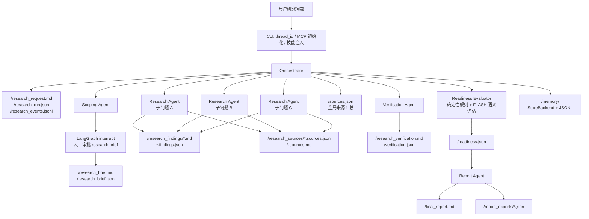

[← 返回 Deep Research 项目速览](/notes/project-defense#deep-research)

> 本页为项目仓库指南的完整收录，收录日期：2026-10-26。保留原文的版本、指标与实现边界；原文中的“当前”指指南编写时的状态。先读[项目深挖速览](/notes/project-defense#deep-research)，再在本页深入理解设计与源码。

# Deep Research 项目指南

这份指南的目标很明确：面试 AI 应用开发岗位时，把这个项目讲成一个“能上线、能审计、能迭代”的 Agent 工程项目，而不是一个“调了 LangChain API 的 Demo”。

## 先把项目讲成一条业务链路

### 30 秒版本

Deep Research 是一个多智能体研究系统，目标是把用户一个模糊研究问题，变成一份有来源、有验证、有结构化状态的最终报告。

我没有把它做成简单的搜索总结循环，而是拆成了一个受控流水线：编排器先做计划，范围界定智能体把问题拆成包含各种子问题的研究简报并请求人工审批，研究智能体按子问题查资料并写结构化 finding，验证智能体检查覆盖和证据质量，readiness evaluator 再做机器可读的报告门禁，只有通过后才让报告智能体生成最终报告和结构化导出。整个过程中，Markdown 给人看，JSON/JSONL 给程序做状态判断。

### 2 分钟版本

这个项目解决的是 AI research agent 的可靠性问题。一个常见做法是让模型自己搜索、总结、写报告，但问题是中间状态不可控：它到底有没有覆盖所有子问题，引用的来源是否有效，什么时候该停止研究，失败后从哪里恢复，这些都很难判断。

我的设计是把研究过程拆成五类角色：Orchestrator、Scoping、Researcher、Verification、Report Writer，再加一个 readiness evaluator。Orchestrator 不直接搜索，它只负责推进流程、委派任务和维护状态。Scoping 负责把用户意图变成 2 到 5 个子问题，并通过 LangGraph interrupt 做一次人工审批，避免一开始方向错了还继续烧搜索预算。Researcher 每次只处理一个子问题，写 Markdown findings，也写 `/research_findings/*.findings.json` 和 `/research_sources/*.sources.json`。Verification 检查覆盖、证据和 gap。Readiness evaluator 再从结构化文件里计算是否能进入报告阶段。

技术上，这个项目用 Deep Agents 做 agent harness，用 LangChain 提供模型、工具和 middleware 抽象，用 LangGraph 提供 checkpoint、interrupt、thread_id 续跑和状态持久化。Deep Agents 的虚拟文件系统很适合这个场景：中间产物先存在 `StateBackend`，只有 `/memory/` 路由到 `StoreBackend` 做跨会话持久化，CLI 最后再把报告和结构化状态落盘。这样可以避免多个研究任务直接写本地磁盘互相覆盖。

最核心的工程点是，我没有只靠 prompt 约束流程，而是把关键规则写进代码：`WorkflowGuardMiddleware` 限制阶段流转，`FileWriteScopeMiddleware` 限制角色写入路径，`SearchUsageLimitMiddleware` 限制搜索预算，`evaluator.py` 用确定性规则检查覆盖率、来源质量和 readiness 新鲜度。模型负责判断和写作，代码负责边界和门禁。

### 一句话定位

这是一个面向复杂研究任务的多 Agent 工作流系统，重点不是“能不能搜到信息”，而是“能不能证明它搜得够、引用得对、状态可恢复、失败可定位”。

## 面试官最想听的主线

### 用户一句话进来后发生了什么

1. CLI 接收用户 query，生成或复用 `thread_id`，初始化 MCP，然后构建 agent。
2. Orchestrator 创建 todo，把原始问题写入 `/research_request.md`，初始化 `/research_run.json` 和 `/research_events.jsonl`。
3. Scoping agent 读取请求，生成 `/research_brief.md`，调用 `request_approval` 触发 LangGraph interrupt。
4. 用户审批通过后，Scoping agent 写 `/research_brief.json`，里面包含用户意图、核心问题、子问题、成功标准和 approved 状态。
5. Orchestrator 按 brief 拆任务，每个 Researcher 只研究一个子问题。
6. Researcher 先做 source routing，再用 Tavily 或 MCP 获取证据，写 findings、source metadata、task-scoped source index 和 finding contract。
7. Orchestrator 合并 task-scoped source indexes，生成全局 `/sources.json`。
8. Verification agent 审计 findings 是否覆盖 brief，写 `/verification.json`。
9. Orchestrator 调 `evaluate_readiness_state`，生成 `/readiness.json`。
10. 只有 verification 和 readiness 都允许，report-agent 才能写 `/final_report.md` 和 `/report_exports/`。
11. 最后 Orchestrator 调 `build_memory_assets`，把可复用研究资产写入 `/memory/`，CLI 把最终文件持久化到本地 `research/` 目录。

面试里可以强调：这条链路里，模型负责“理解和生成”，代码负责“状态、权限、门禁和可恢复性”。

## 架构怎么画

讲图时不要从框架名开始。先说用户问题如何被拆解、审批、研究、验证、报告，再说这些能力分别借了 LangGraph、Deep Agents、LangChain 哪一层。

## 技术栈怎么讲

### LangChain、LangGraph、Deep Agents 的分工

项目里的分工可以这样讲：

LangChain 是底层组件层，提供 `ChatOpenAI`、tool、middleware 和 `create_agent` 这类抽象。项目里 `src/llm.py` 用 `langchain_openai.ChatOpenAI` 初始化不同角色模型，`src/tools.py` 里的工具都用 `@tool(parse_docstring=True)` 暴露给模型，middleware 也继承自 LangChain 的 `AgentMiddleware`。

LangGraph 是运行时层，负责持久执行、checkpoint、interrupt、thread_id 和 resume。项目里 `request_approval` 直接调用 `langgraph.types.interrupt`，CLI 收到 `__interrupt__` 后用 `Command(resume=approval)` 继续执行。`MemorySaver` 是当前本地 checkpoint，面试时要主动说生产环境应该换成持久化 checkpointer。

Deep Agents 是 harness 层，提供 `create_deep_agent`、subagents、虚拟文件系统 backend、skills 和 memory 组合能力。项目里 `src/agent.py` 用 `create_deep_agent` 注册 Orchestrator、工具、四个 subagent、middleware、backend 和 store。

可以顺手补一句：官方文档里 Deep Agents 被描述为带任务规划、文件系统、subagent 和长期记忆的 agent harness，底层仍然建立在 LangChain 和 LangGraph 之上。本项目正好把这三层按职责拆开用。

### 为什么用 Deep Agents

这个项目需要的不只是 tool calling，而是一个能长期推进复杂任务的工作台：要有文件系统存中间产物，要能把任务委派给不同角色，要支持人机审批，要能在同一个 thread 里恢复，还要能把长期记忆从当前任务状态里拆出去。Deep Agents 的 `StateBackend`、`StoreBackend`、subagents 和 skills 正好对应这些需求。

过度设计的边界也要讲清楚。如果只是“用户问一句，模型调一个搜索工具，再总结一句”，Deep Agents 和 LangGraph 都偏重。这个项目用了它们，是因为流程里有真实的阶段、分支、审批、状态文件、跨角色写入权限和最终报告门禁。

### 为什么用 LangGraph interrupt

Scoping 阶段是最值得中断的地方。研究任务一旦开始，会消耗搜索预算和模型 token，如果 scope 理解错了，后面所有动作都会错。项目用 `request_approval` 在 brief 生成后暂停，CLI 展示待审批内容，用户批准后才继续。

面试官追问 checkpoint 时可以这样答：

interrupt 不是普通 input，它会让图暂停并保存状态。resume 时必须用同一个 `thread_id`，`Command(resume=...)` 会成为 `interrupt()` 在工具内部的返回值。需要注意的是，LangGraph resume 时会从触发 interrupt 的节点重新执行，所以 interrupt 前的副作用要么幂等，要么放到 interrupt 后。本项目把审批前后状态写入做得比较克制，主要副作用集中在批准之后写 `/research_brief.json`。

### 为什么用虚拟文件系统

研究过程有很多中间产物，直接落本地磁盘会带来几个问题：多用户冲突、并行任务覆盖、权限边界不清、服务端部署不方便。Deep Agents 的 `StateBackend` 把这些文件存在 LangGraph state 里，同一个 thread 可以通过 checkpoint 恢复，subagent 写的文件也能被 Orchestrator 和其他 subagent 读取。

项目没有把所有内容都放进一个巨大 state dict，而是用虚拟路径表达职责：

- `/research_brief.json` 是已审批的研究范围
- `/research_findings/*.findings.json` 是每个研究任务的机器契约
- `/research_sources/*.sources.json` 是每个任务自己的来源索引
- `/sources.json` 是 Orchestrator 合并后的全局来源索引
- `/verification.json` 是验证结论
- `/readiness.json` 是报告门禁
- `/report_exports/*.json` 是报告的结构化导出
- `/memory/` 是跨会话长期记忆

这个设计的好处是：文件名就是边界，检查逻辑也能围绕这些边界写成确定性代码。

## 项目里最能打的工程亮点

### 亮点一：用代码门禁代替纯 prompt 约束

很多 Agent 项目失败在“希望模型按流程做”。本项目把关键流程写进 `WorkflowGuardMiddleware`：

- Research 必须等 `/research_brief.json` 存在且 approved 为 true。
- Research task 的描述必须包含 brief 里的已批准子问题。
- Verification 必须等每个子问题都有完整 finding contract。
- Finding 里引用的 `source_ids` 必须存在于对应 task-scoped source index。
- Report 必须等 `/verification.json` 表示 ready，且没有 CRITICAL/HIGH gap。
- Report 还必须等 `/readiness.json` 是 READY，并且 input snapshot 没过期。

面试表达：

我把 workflow 从“提示词里的建议”提升成“代码里的硬约束”。模型可以决定怎么写、怎么查，但不能绕过审批、验证和 readiness。这样线上出问题时，也能知道是哪个 gate 拦住了，而不是只看到一段模型输出。

### 亮点二：角色级文件写入权限

`FileWriteScopeMiddleware` 把每个角色能写的路径锁死：

- Orchestrator 写 `/research_run.json`、`/sources.json`、`/readiness.json` 和 `/memory/`
- Scoping 写 brief
- Research 写 `/research_findings/`、`/research_sources/`、`/research_events/`
- Verification 写 verification
- Report 写 final report 和 report exports

它还会拦截 `..` 父路径引用，避免模型通过路径绕过权限。

面试表达：

这是把 Agent 的权限模型做小。Researcher 不应该能覆盖全局 `/sources.json`，Report Writer 不应该能改 `/research_run.json`。角色边界越清楚，出了问题越容易定位。

### 亮点三：并行研究不共享写全局状态

多个 Researcher 研究不同子问题时，最容易出现最后写入者覆盖前面结果的问题。本项目让 Researcher 只写自己的 task-scoped 文件：

- `/research_findings/<topic>.md`
- `/research_findings/<topic>.findings.json`
- `/research_sources/<topic>.sources.md`
- `/research_sources/<topic>.sources.json`
- `/research_events/<topic>.jsonl`

全局 `/sources.json` 只由 Orchestrator 在所有研究任务结束后合并。

面试表达：

这里的重点不是“我开了几个线程”，而是并行安全。子任务只能写自己的局部产物，全局状态由一个角色统一合并，避免并发写共享文件。

### 亮点四：readiness evaluator 是停止条件

很多研究 Agent 不知道什么时候该停。本项目用 `src/evaluator.py` 把“能不能写报告”变成可计算状态。

确定性规则会检查：

- brief 是否存在且 approved
- brief 里的每个 sub-question 是否有 complete finding
- finding 是否有有效 source-backed evidence
- source index 是否缺失
- finding 引用的 `source_ids` 是否能在 source index 找到
- 来源是否是 rejected、attempted、failed、empty、duplicate、out_of_scope
- verification 是否有 CRITICAL/HIGH gap
- research budget 是否耗尽

评分权重也很清楚：覆盖率 50%，来源健康 25%，verification gap 25%。只要有 critical blocker，状态就是 BLOCKED。否则根据 blocker 和分数决定 READY 或 NEEDS_MORE_RESEARCH。

面试表达：

我没有让模型自己说“差不多够了”。模型可以给语义判断，但硬规则先判断结构完整性和证据有效性。只有 readiness 给出 `overall_status: READY` 和 `recommendation: proceed_to_report`，报告阶段才会放行。

### 亮点五：stale readiness 防护

`/readiness.json` 里有 `input_snapshot`，记录参与评估的结构化输入文件 hash 和 size。Report gate 会重新计算当前 snapshot，如果 findings、sources 或 verification 变了，旧 readiness 不能继续用。

面试表达：

这个点解决的是“评估和输入不一致”。如果验证后又改了 findings，原来的 READY 结论就不可信了，所以 report gate 必须要求 readiness 刷新。

### 亮点六：来源质量从记录层开始管

`SourceRecord` 不只是 title 和 url，还包含：

- `status`: attempted、accepted、rejected、digested、cited
- `source_type`: web、mcp、local_file、other
- `route`: web_search、mcp、local_file、unsupported
- `quality_status`: usable、failed、empty、duplicate、out_of_scope、unknown
- `failure_reason`
- `content_hash`

schema 里规定 attempted 和 rejected 必须带 `failure_reason`，accepted、digested、cited 如果有 quality_status，必须是 usable。evaluator 再把无效来源排除出有效证据。

面试表达：

我把来源当成有生命周期的对象，而不是引用列表。搜到一个 URL 不代表它能当证据，失败、空内容、重复和范围外来源都要记录，但不能计入有效 evidence。

### 亮点七：长期记忆不绕过当前流程

项目把 `/memory/` 路由到 `StoreBackend`，底层是自实现的 `JsonlMemoryStore`。长期记忆包括 run record、topic record、source record 和 topic index。

关键点是，`build_memory_assets` 有严格门禁：

- `/research_run.json`、`/research_brief.json`、`/readiness.json`、`/final_report.md` 必须存在
- readiness 必须 READY 且 recommendation 是 proceed_to_report
- run 必须 completed 或处于 reporting/report 阶段
- `/report_exports/report_summary.json`、`/report_exports/source_appendix.json`、`/report_exports/export_manifest.json` 必须存在
- manifest 必须列出必需导出文件

面试表达：

我把长期记忆当成“完成后可复用的研究资产”，不是每轮对话都无脑写入。它只能作为下一次研究的背景，不能替代 scope、verification 和 readiness gate。

## 各模块怎么介绍

### `src/agent.py`

这是总装配入口。`build_agent()` 调 `create_deep_agent`，注册主模型、Orchestrator 工具、四个 subagent、两个 middleware、checkpointer、backend 和 store。

可讲点：

- `CompositeBackend` 默认走 `StateBackend`，只有 `/memory/` 走 `StoreBackend`。
- `store=memory_store` 接的是本地 JSONL store。
- `WorkflowGuardMiddleware` 和 `FileWriteScopeMiddleware(role="orchestrator")` 挂在主 agent 上。
- `MemorySaver` 当前适合本地运行，生产要换持久化 checkpoint。

### `src/subagents/*.py`

每个 subagent 都是一个 dict factory，包含 name、description、system_prompt、tools、middleware、model。它们是无状态的，每次调用要由 Orchestrator 带完整上下文和输出路径。

可讲点：

- Scoping 有 `request_approval`，负责 HITL。
- Research 有 Tavily、source routing、source metadata、finding contract、search budget middleware。
- Verification 只写 verification 状态。
- Report 只写 final report 和 report exports。

### `src/tools.py`

这是结构化状态和外部能力的主要入口。

可讲点：

- `tavily_search` 用 Tavily 找 URL，再用 `httpx.AsyncClient` 并发抓网页，用 `markdownify` 转 Markdown。
- `route_research_source` 决定走 web_search、mcp、local_file 还是 unsupported。
- `build_*_state` 系列工具把 Pydantic 模型转成版本化 JSON。
- `evaluate_readiness_state` 先跑确定性 evaluator，没 critical blocker 才调用 FLASH 模型做语义补充。
- `request_approval` 用 LangGraph interrupt 挂起流程。

### `src/schemas.py`

这是机器可读状态的契约层。所有结构化文件都对应 Pydantic 模型，字段里有 description，能直接变成工具 schema。

可讲点：

- 让 LLM 输出结构化数据时，schema 不是事后校验，而是提示模型按工具输入生成。
- `SourceRecord` 里有质量契约，防止失败来源被当证据。
- `ReadinessState` 里同时保留 blocking reasons、warnings、source health、sub-question coverage 和 recommendation。

### `src/evaluator.py`

这是 readiness 的确定性核心，不依赖模型也能工作。

可讲点：

- 模型失败时不能让流程崩掉，FLASH 只是补充判断。
- 硬规则要先于语义判断，比如 source id 缺失、brief 未审批、readiness 过期。
- `build_input_snapshot` 是 stale readiness 防护的基础。

### `src/memory_store.py`

这是本地 JSONL-backed LangGraph `BaseStore` 实现。

可讲点：

- append-first JSONL 适合本地开发，重放日志可恢复 store 状态。
- 支持 get、put、search、list namespaces 和 async batch。
- 加了锁，避免同进程并发写乱序。

### `src/cli.py`

这是用户入口和持久化边界。

可讲点：

- CLI 负责初始化 MCP，构建 agent，处理 interrupt，resume 后继续执行。
- 最终从 StateBackend 提取虚拟文件，落盘到 `research/`。
- `thread_id` 是续跑指针，不是业务问题本身。

### `evals/`

这是项目的评测体系，不只是 pytest 单测。

可讲点：

- `single-step` 检查 scoping、research tool choice、verification、report。
- `full-turn` 检查完整研究链路。
- `multi-turn` 检查同一个 `thread_id` 的连续性。
- mocked 模式用确定性搜索 fixture，live 模式跑真实模型和 Tavily。
- 可选 LLM judge 检查报告是否回答问题、是否基于 findings、是否有引用和幻觉风险。

## 面试高频追问和建议回答

### 为什么不直接让一个 Agent 搜索并写报告

单 Agent 可以跑通 Demo，但线上问题很难定位。它什么时候该停、是否覆盖所有子问题、引用来源是否有效、失败后从哪里恢复，都没有稳定边界。

我这里拆成多个角色，不是为了堆概念，而是把职责拆开：Scoping 控制方向，Research 只负责证据，Verification 负责审计，Readiness 负责可计算停止条件，Report 只做最终表达。这样每一步都有产物，有门禁，也能单独测试。

### 为什么不只靠 prompt

prompt 适合表达意图，但不适合做权限和流程控制。比如“不要在 brief 审批前搜索”，模型可能忘；“research-agent 不要写 `/sources.json`”，模型也可能误写。

所以项目里把这些规则下沉到 middleware。prompt 告诉模型应该怎么做，middleware 决定它能不能做。

### 为什么需要 `/readiness.json`，verification 不够吗

Verification 是一个智能体的质量审计，适合检查语义完整性和研究质量，但它本身还是模型输出。Readiness 是机器可读的客观门禁，能检查结构化文件是否齐全、source id 是否对得上、来源质量是否可用、verification 是否还有高优先级 gap、输入是否变化。

两者分工是：Verification 看内容质量，Readiness 看流程和证据契约能不能支撑报告输出。

### 为什么要维护 Markdown 和 JSON 两套状态

Markdown 给人读，也方便模型综合和写报告。JSON/JSONL 给程序读，用于 workflow guard、readiness evaluator、CLI 持久化和长期记忆。

只用 Markdown，程序很难可靠判断“这个子问题是否 complete”或“source_id 是否存在”。只用 JSON，人工审阅和报告写作又不自然。这个项目保留两层，是为了让人和机器各自读适合自己的格式。

### checkpoint 和 memory 有什么区别

checkpoint 是当前线程的执行状态，用来恢复这一次任务。比如 interrupt 后用同一个 `thread_id` resume。

memory 是跨会话复用的研究资产，比如某个 topic 的历史报告摘要、source first-seen 信息和 topic index。checkpoint 服务当前流程，memory 服务未来流程。这个项目把普通运行文件放在 StateBackend，把 `/memory/` 路由到 StoreBackend，就是为了划清这条边界。

### thread_id 怎么设计

当前 CLI 默认生成 `research-<随机短 id>`，也允许用户通过 `--thread-id` 续跑。面试可以说：在服务端部署时，我会把 LangGraph 的 thread_id 当作编排游标，业务主键作为 state 字段保存，不把订单号、用户问题和 checkpoint id 混成一个东西。

### MCP 在项目里怎么用

MCP 是可选数据源接入层。项目启动时读取 `mcp_config.json`，用 `MultiServerMCPClient` 初始化工具。如果 MCP 工具可用，就把工具加入 research-agent，并把能力描述注入 researcher prompt。Researcher 会先调用 `route_research_source`，当问题和 MCP capabilities 匹配时优先建议 MCP，失败或不匹配再走 Web。

这里的重点是“能力发现和路由”，不是无脑把所有工具塞给模型。

### Source routing 有什么价值

它让来源获取变成显式决策。Web、MCP、local_file、unsupported 不是混在一起，而是有 route、source_type、fallback_routes、status 和 warnings。

当前 Phase 5 v1 没实现真实 local-file ingestion，只记录 route contract。这个点面试时要主动说，避免被追问时显得夸大。

### 搜索预算怎么控制

项目有两层控制。prompt 里建议简单问题 2 到 3 次搜索、复杂问题 4 到 5 次搜索，代码里 `SearchUsageLimitMiddleware` 对 `tavily_search` 做硬上限，默认来自 `RESEARCH_SEARCH_TOOL_LIMIT=15`。到达上限时，工具返回会明确要求停止搜索并综合已有结果。

面试可以补一句：预算不是为了省钱这么简单，也是为了避免 Agent 空转和重复搜索。

### 如何处理模型失败或语义评估失败

`evaluate_readiness_state` 会先跑确定性 evaluator。如果有 critical blocker，直接返回，不浪费 FLASH 模型调用。如果没有 critical blocker，再调用 `assess_semantic_readiness`。如果 FLASH 调用失败，代码会记录 warning，保留确定性 readiness，不让整个流程崩掉。

这个回答能体现你知道模型调用是外部依赖，失败是正常情况。

### 为什么 report exports 必须存在后才能写 memory

长期记忆不是为了存一份最终报告，而是为了给未来研究提供可检索的结构化资产。`report_summary.json` 提供摘要，`source_appendix.json` 提供来源列表和失败来源信息，`export_manifest.json` 确认导出完整。如果这些不存在，memory 写进去就不完整，下一次读取会污染上下文。

### 项目如何评测

本项目有三层评测：

- 单元测试：测 middleware、schema、evaluator、memory store、MCP 生命周期等确定性逻辑。
- 流程评测：`evals/` 通过 public graph entrypoints 跑 single-step、full-turn、multi-turn。
- 报告质量评测：可选 LLM judge 检查 final report 是否回答问题、是否基于 findings、结构是否清晰、是否引用来源、幻觉风险。

这比只看一次人工运行结果可靠，因为它能把 prompt、工具、状态和报告产物一起纳入回归。

## 可以主动承认的短板

### 生产 checkpoint 还需要替换

当前 `src/agent.py` 用的是 `MemorySaver`。它适合本地开发和 CLI 演示，但生产环境应该换成 Postgres、Redis 或 LangGraph 平台提供的持久 checkpointer。否则进程重启后，thread checkpoint 会丢。

这样讲不是自曝短板，而是说明你知道本地 demo 和生产部署的边界。

### memory namespace 需要多租户隔离

当前 `StoreBackend` 的 namespace 是常量 `("deep_research", "memory")`，适合本地单用户项目。多用户部署时，需要把 user_id、tenant_id 或 assistant_id 纳入 namespace，避免不同用户共享记忆。

### local-file ingestion 只是路由契约

项目已经有 `local_file` route 和 source schema，但 Phase 5 v1 没做真实本地文件解析。面试时可以说：这部分我保留了接口边界，但没有在没有安全设计的情况下直接让 Agent 读本地文件。

### “并行研究”的关键是状态隔离，不一定是物理并发

代码和 prompt 支持把多个研究任务拆开执行，并且通过 task-scoped 文件避免共享状态覆盖。但实际执行并发度要看 Deep Agents/LangGraph 的调度方式和调用模式。面试里不要夸成自己手写了复杂并发调度，可以说这个项目先解决了并行安全的状态设计。

### 来源可信度还能继续增强

当前来源质量主要检查 status、quality_status、failure_reason、source id 和 duplicate URL。后续可以加 domain allowlist、publisher trust score、内容 hash 去重、引用 span 校验、时间新鲜度规则、cross-source contradiction 检测。

## 简历上可以怎么写

### 版本一，偏工程实现

设计并实现一个基于 Deep Agents、LangChain 和 LangGraph 的多智能体深度研究系统，将模糊用户问题拆解为可审批 research brief、并行 research findings、verification 结果、readiness gate 和最终引用报告。通过 WorkflowGuardMiddleware、FileWriteScopeMiddleware 和 SearchUsageLimitMiddleware 将审批、阶段流转、角色写入权限和搜索预算从 prompt 约束下沉为代码门禁。

### 版本二，偏 Agent 可靠性

构建面向复杂研究任务的 Agent 工作流，使用 StateBackend 管理线程级虚拟工作区，使用 StoreBackend 和本地 JSONL store 持久化跨会话研究记忆。引入 Pydantic 结构化状态、source lifecycle schema、readiness evaluator 和 stale snapshot 检查，确保最终报告只有在研究覆盖、来源质量、验证结果和报告导出均通过后才生成。

### 版本三，偏评测和上线

为多智能体研究系统建立回归评测链路，覆盖 scoping、research tool selection、verification、report generation、full-turn 和 multi-turn 场景。支持 mocked/live 两种模式，可选 LangSmith tracing 和 LLM judge，对搜索预算、必需产物、引用质量、报告结构和人工审批中断进行自动化检查。

## 项目介绍时别这么说

不要说：

- 我用了 LangChain、LangGraph、Deep Agents、Tavily。
- 我做了一个多智能体系统，可以自动研究任何问题。
- 我加了 memory，所以它越用越聪明。
- 我用了 MCP，所以可以接任何工具。

建议改成：

- 我把研究过程拆成可审计的状态机，每一步都有明确产物和门禁。
- 用户问题先变成已审批 brief，再变成子问题级 findings，最后通过 verification 和 readiness 才能写报告。
- memory 只在完成报告后写入，并且不能跳过当前 run 的审批和验证。
- MCP 是可选来源路由，只有能力描述匹配时才进入 researcher 的工具集。

## 可准备的追问清单

### LangGraph

1. interrupt 和普通用户输入有什么区别？
2. checkpoint 存什么？thread_id 为什么重要？
3. resume 后节点会不会重跑？副作用怎么处理？
4. 为什么当前用 MemorySaver，生产怎么替换？
5. 如果一个节点里有多个 interrupt，resume value 如何对应？

### Agent 架构

1. 为什么拆成四个 subagent？
2. 为什么 Orchestrator 不直接搜索？
3. subagent 无状态有什么好处和代价？
4. 多 Agent 会不会增加调试难度？
5. 如何防止 Researcher 越权写全局状态？

### 状态和数据契约

1. Markdown 和 JSON 为什么都要保留？
2. `/readiness.json` 和 `/verification.json` 有什么区别？
3. finding contract 解决了什么问题？
4. source id 不一致会在哪里被发现？
5. input snapshot 为什么能防止 stale readiness？

### 工具和 MCP

1. Tool、Skill、MCP 在项目里分别是什么？
2. 为什么不把所有工具一次性塞给模型？
3. MCP 失败后怎么 fallback？
4. local_file 为什么只做 route contract？
5. source routing 和普通搜索有什么区别？

### 评测和上线

1. 如何判断 Agent 真的做对了？
2. mocked eval 和 live eval 分别解决什么问题？
3. 如何观察搜索预算、工具失败率和报告质量？
4. bad case 如何进入回归集？
5. 如果线上发现报告引用了无效来源，如何定位？

## 面试时可以直接背的回答

### 回答一：为什么这个项目不是普通 RAG

普通 RAG 重点是检索和生成，这个项目重点是研究工作流。它也有来源获取，但我更关心从用户问题到最终报告之间的状态演化：scope 是否被批准，子问题是否全覆盖，finding 是否有对应 source index，source 是否能当证据，verification 是否还有高优先级 gap，readiness 是否基于最新输入。RAG 是其中的信息获取部分，不是整个系统。

### 回答二：这个项目的难点在哪里

难点不在调模型，而在让模型产物变成可判断、可恢复、可追责的工程状态。比如 Researcher 写了一段 findings，人读起来可能还行，但程序不知道它对应哪个子问题、用了哪些 source、source 是否有效。所以我加了 finding contract、source index、verification 和 readiness，把自然语言产物旁边补一层机器可读契约。

### 回答三：为什么要有人机审批

研究型 Agent 最怕一开始理解错方向。Scope 错了，后面搜得越多浪费越大。审批点放在 brief 之后、research 之前，这时成本最低，而且用户能看到核心问题、子问题、范围外内容和成功标准。审批通过后再研究，能减少返工和无效 API 调用。

### 回答四：如何降低幻觉

我不把幻觉只当成模型问题，而是从流程上压低风险。第一，研究结果必须绑定 source id。第二，source id 必须存在于 task source index。第三，attempted、rejected、failed、empty、duplicate、out_of_scope 的来源不能算有效证据。第四，verification 会检查 unverified 和 contradicted claims。第五，report 必须等 readiness READY 才能生成。这样即使模型有生成倾向，流程也会要求它把结论落到可检查的证据上。

### 回答五：如何控制成本

成本主要从四处控制：Scoping 先审批，避免方向错导致无效研究；Researcher 每个任务只研究一个子问题，减少重复搜索；SearchUsageLimitMiddleware 对 Tavily 调用做硬上限；FLASH_MODEL_ID 用低成本模型做语义 readiness，主模型只放在编排和关键生成环节。后续还可以加缓存、来源去重和 query 合并。

### 回答六：如何从失败中恢复

流程状态都在 thread state 里，配合 LangGraph checkpoint 和 thread_id 可以恢复当前运行。每个阶段都有结构化文件，失败后能看 `/research_run.json` 的 current_phase、`/research_events.jsonl` 的事件、各 subagent 的输出文件和 guard 返回码。比如 report 被拦住，可以直接看是 verification 未 ready、readiness missing、readiness stale，还是 source quality invalid。

## 如果面试官让你讲源码细节

可以按这个顺序：

1. `src/agent.py`：总装配，用 `create_deep_agent` 把模型、工具、subagents、middleware、backend、store 接起来。
2. `src/prompts.py`：定义 Orchestrator 和四个角色的流程提示，要求每一步写哪些虚拟文件。
3. `src/tools.py`：工具层，包含 Tavily 搜索、source routing、approval interrupt、结构化 state builder、readiness 和 memory asset builder。
4. `src/schemas.py`：Pydantic 契约，保证工具输入和结构化状态一致。
5. `src/middleware/`：硬门禁，防止流程越权和文件越权。
6. `src/evaluator.py`：确定性 readiness，决定能不能进入报告。
7. `src/cli.py`：运行入口，处理 interrupt/resume，并把虚拟文件持久化到本地。
8. `evals/` 和 `tests/`：证明这些规则不是只写在文档里，而是有回归检查。

## 可以讲的技术取舍

### StateBackend vs 本地文件

StateBackend 更适合服务端和多用户任务，因为中间文件跟 thread 绑定，不会污染本地目录。缺点是大文件和长期保存不适合一直放在 state 里，所以项目只把最终结果由 CLI 落盘，长期可复用资产走 StoreBackend。

### StoreBackend vs 向量库

当前 memory 是 topic/source/run 的结构化记录，用 JSONL store 就够了。它更像研究资产索引，不是语义检索系统。如果后续 memory 规模变大，可以把 topic summary 和 source summary 接入向量库，但那是读 memory 的增强，不影响当前 workflow gate。

### 确定性 evaluator vs LLM judge

确定性 evaluator 适合检查结构完整性和硬规则，比如 source id、status、gap priority、snapshot。LLM judge 适合判断报告是否答题、逻辑是否连贯、是否有明显幻觉。两者不能互相替代。

### 多模型配置

`MAIN_MODEL_ID` 给 Orchestrator，`REPORT_MODEL_ID`、`RESEARCH_MODEL_ID`、`SCOPING_MODEL_ID`、`VERIFY_MODEL_ID` 可以分别覆盖角色模型，`FLASH_MODEL_ID` 给低成本 readiness 语义判断。temperature 全部是 0.0，降低流程型任务的不确定性。

## 你可以反问面试官的问题

1. 你们现在的 Agent 产物是只保存在对话里，还是有机器可读状态？
2. 你们怎么判断一个 Agent 任务“可以停止”？
3. 工具失败、来源无效、引用错位时，现在是靠人工发现还是有自动 gate？
4. 如果引入 memory，你们会默认每轮写入，还是只在任务完成后写入？
5. 多 Agent 系统里，角色权限是 prompt 约束还是代码约束？

这些问题能把讨论拉回工程质量，不会停在“会不会调框架”。

## 最后要记住的表达顺序

面试时按这个顺序讲：

1. 业务问题：复杂研究任务不能只靠搜索总结，需要可审计流程。
2. 系统链路：scope、research、verify、readiness、report、memory。
3. 状态设计：Markdown 给人看，JSON/JSONL 给程序判断。
4. 硬约束：workflow guard、file write scope、search budget。
5. 质量闭环：source lifecycle、readiness evaluator、evals。
6. 技术栈：Deep Agents 是 harness，LangGraph 是运行时，LangChain 是组件层。
7. 取舍和短板：MemorySaver、namespace、多租户、local-file ingestion、来源可信度增强。

这个顺序比一上来报框架名更稳。它先回答“为什么做”，再回答“怎么做”，最后回答“为什么这个方案靠谱”。

## 参考资料

- LangChain Docs: Deep Agents overview, https://docs.langchain.com/oss/python/deepagents/overview
- LangChain Docs: Customize Deep Agents, https://docs.langchain.com/oss/python/deepagents/customization
- LangChain Docs: Deep Agents backends, https://docs.langchain.com/oss/python/deepagents/backends
- LangChain Docs: Deep Agents human-in-the-loop, https://docs.langchain.com/oss/python/deepagents/human-in-the-loop
- LangGraph Docs: Interrupts, https://docs.langchain.com/oss/python/langgraph/interrupts
- 项目源码：`src/agent.py`、`src/tools.py`、`src/evaluator.py`、`src/middleware/`、`src/schemas.py`
- 项目测试：`tests/`、`evals/`
